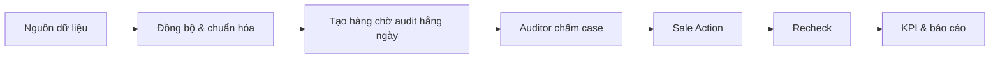
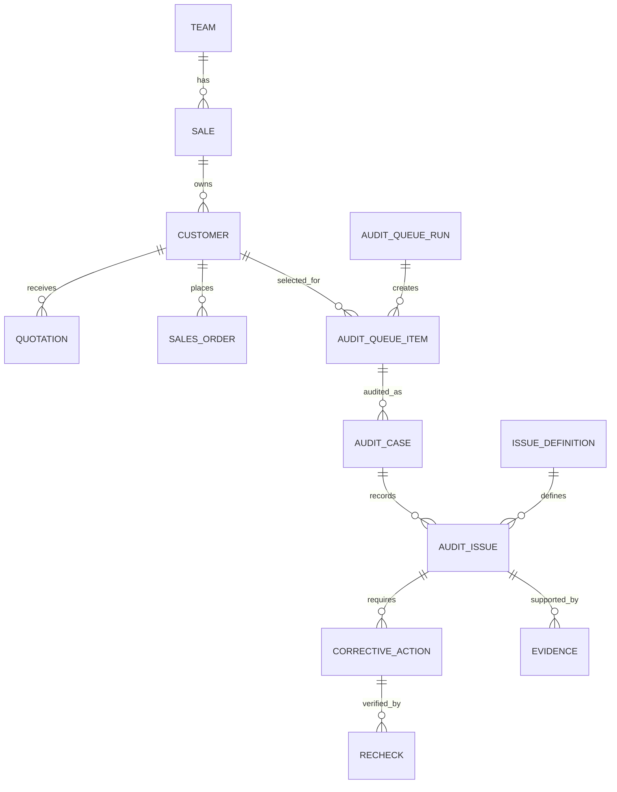

# AuditFlow Operating Specification

**Phiên bản:** 1.1  
**Múi giờ chuẩn:** `Asia/Ho_Chi_Minh`  
**Mục tiêu:** Phát hiện rủi ro vận hành sale hằng ngày, audit có bằng chứng, giao việc khắc phục và recheck đến khi hoàn tất.

## 1. Phạm vi vận hành

AuditFlow dùng dữ liệu khách hàng, báo giá, đơn hàng, sale và team để tạo hàng chờ audit mỗi ngày. Mỗi khách chỉ có một dòng trong hàng chờ của một ngày, nhưng có thể có nhiều loại case và nhiều lỗi audit. Queue là bản ghi nhận rủi ro tại thời điểm tạo; không tự thay đổi theo dữ liệu nguồn đến muộn hoặc thay đổi sau đó.

Luồng chuẩn:

## 2. Vai trò và quyền

| Vai trò | Quyền chính |
|---|---|
| Head Auditor | Xem toàn bộ, cấu hình rule/catalog, duyệt mức độ lỗi, quản lý phân công và KPI auditor |
| Auditor | Xem portfolio sale được phân công, audit, tạo action, hướng dẫn khắc phục, recheck và quyết định đóng/mở lại action |
| Sale | Xem action/case thuộc mình, xác nhận đã thực hiện và tải evidence |
| Team Lead | Xem action quá hạn, KPI và metadata case của team; không xem hội thoại/evidence nếu không được cấp quyền riêng |
| Admin | Quản lý nguồn dữ liệu, lịch đồng bộ và tài khoản |

Mọi thao tác ghi phải kiểm tra `app_user_profile.is_active`. Các thao tác đồng bộ thủ công chỉ dành cho Head Auditor; lịch tự động dùng credential nội bộ.

## 3. Mô hình dữ liệu

| Đối tượng | Mục đích |
|---|---|
| Customer | Khách hàng, số điện thoại chuẩn hóa, sale/team hiện hành |
| Quotation | Báo giá, ngày báo giá, giá trị, sale phụ trách |
| Sales Order | Đơn hàng, ngày đơn hàng, số điện thoại chuẩn hóa |
| Audit Queue Run | Một lần tạo queue cho một ngày audit |
| Audit Queue Item | Một khách được chọn audit trong một ngày, có snapshot lý do, owner và trạng thái xử lý |
| Audit Case | Một lần chấm hoàn tất hoặc bỏ qua của Queue Item |
| Audit Issue | Một hoặc nhiều lỗi trong Audit Case |
| Issue Definition | Catalog lỗi và rule mức độ hiện hành |
| Corrective Action | Việc sale phải khắc phục, người chịu trách nhiệm, hạn xử lý |
| Recheck | Kết quả kiểm tra lại một action |
| Evidence | Ảnh, file hoặc liên kết chứng minh audit/khắc phục/recheck |

### Snapshot và tính bất biến

- Khi tạo `Audit Queue Item`, lưu `rule_version`, tag, record ID nguồn, ngày nguồn, `customer_id`, `sale_id`, `team_id` và thời điểm đồng bộ dùng để tính rule.
- Khi auditor tạo `Audit Case` hoặc `Corrective Action`, tiếp tục snapshot sale/team/manager chịu trách nhiệm tại thời điểm tạo. Báo cáo lịch sử dùng snapshot, không dùng owner hiện hành.
- Thay đổi nguồn sau khi queue được tạo không làm mất, thêm hoặc sửa tag của queue đã chốt. Nó chỉ được phản ánh ở queue run kế tiếp hoặc ở recheck.
- Khi sale/team đổi, action đang mở giữ owner cũ cho đến khi Head Auditor chuyển giao có ghi nhận lý do; mọi lần chuyển giao phải có lịch sử.

### Phân công auditor theo portfolio sale

- Có ba auditor hoạt động. Mỗi sale được gán cho đúng một auditor chính tại một thời điểm; mục tiêu là auditor theo sát cố định portfolio sale của mình.
- Cấu hình `Auditor Assignment` tối thiểu có: `sale_id`, `auditor_id`, `effective_from`, `effective_to`, `assignment_reason`, `created_by`, `created_at` và `is_active`.
- Không được ghi đè phân công cũ. Khi sale đổi team hoặc Head Auditor cân bằng tải, đóng assignment cũ bằng `effective_to` và tạo assignment mới có hiệu lực từ ngày được chọn. Hệ thống chặn hai assignment hiệu lực đồng thời cho cùng một sale.
- Queue run ngày `D` lấy auditor có assignment hiệu lực tại `D`, sau đó snapshot `assigned_auditor_id` vào Queue Item. Đổi cấu hình sau khi queue đã tạo không tự đổi người audit của queue cũ.
- Head Auditor có thể reassign một Queue Item hoặc action riêng lẻ khi vắng mặt/xung đột quyền; bắt buộc ghi lý do. Việc này không làm thay đổi portfolio mặc định của sale.
- Khi sale đổi team, hệ thống hiển thị cảnh báo và danh sách sale cần rà soát phân công. Sale vẫn ở auditor cũ cho đến khi Head Auditor tạo assignment mới; không tự chuyển theo team để tránh đổi owner ngoài ý muốn.
- Nếu muốn quản lý theo team, cấu hình có thể tạo assignment hàng loạt theo team, nhưng kết quả luôn được lưu thành assignment theo từng sale để xử lý ngoại lệ linh động.

## 4. Rule tạo hàng chờ hằng ngày

Ngày audit là `D`, theo múi giờ `Asia/Ho_Chi_Minh`. Dữ liệu phát sinh trong ngày `D` không được dùng để đánh giá các rule dưới đây.

| Mã case | Điều kiện | Hiển thị |
|---|---|---|
| `YESTERDAY_CUSTOMERS` | `first_seen_date = D - 1` | Khách hôm qua |
| `NO_QUOTATION` | `first_seen_date` trong `[D - 2, D - 1]`, có số điện thoại chuẩn hóa, có sale hiện hành, chưa có báo giá đến hết `D - 1` | Chưa báo giá 2 ngày |
| `QUOTED_NOT_ORDERED` | Lấy **báo giá mới nhất** của khách trong `[D - 7, D - 1]`; không có đơn hàng hợp lệ của khách có `order_date` từ ngày báo giá đó đến hết `D - 1` | Báo giá chưa chốt 7 ngày |

### Quy tắc gộp

- Một khách có tối đa một `Audit Queue Item` trong cùng ngày audit.
- Các case được gộp thành nhiều tag trên cùng một dòng khách.
- Một khách tạo hôm qua nhưng chưa báo giá có hai tag: `Khách hôm qua` và `Chưa báo giá 2 ngày`.
- Queue chỉ được tạo sau khi nguồn khách, sale, báo giá và đơn hàng đã đồng bộ/chuẩn hóa xong.
- Với một khách có nhiều báo giá, chỉ xét báo giá mới nhất đủ điều kiện. Đơn hàng bị hủy/nháp không được tính là đã chốt; quy tắc mapping quotation--order phải được cấu hình nếu nguồn hỗ trợ liên kết trực tiếp.
- Nếu queue đã có case được audit, không tự tái tạo queue; Head Auditor phải xử lý theo runbook.
- Queue vẫn có thể hiển thị khách có rủi ro lặp lại, nhưng không được tạo action trùng cho cùng `customer + issue_code` khi còn action đang mở/chờ recheck. Hiển thị trạng thái `Đang theo dõi` và liên kết tới action hiện có.

## 5. Quy trình audit

1. Hệ thống gán auditor theo `Auditor Assignment` hiệu lực tại ngày queue; auditor không được audit case của chính mình hoặc sale do mình trực tiếp quản lý. Queue chưa được phân công có trạng thái `UNASSIGNED`.
2. Auditor lọc queue theo ngày, team, sale hoặc loại case.
3. Auditor mở case, xem snapshot lý do vào queue, thông tin khách, sale, báo giá, lịch sử và evidence được phép xem.
4. Auditor chấm hội thoại hoặc audit quy trình.
5. Một case không đạt phải có ghi chú và ít nhất một lỗi; lỗi có yêu cầu evidence phải có evidence trước khi gửi hoàn tất.
6. Một case có thể chọn nhiều lỗi.
7. Mỗi lỗi lưu snapshot: code, tên, mức độ và cờ lỗi nghiêm trọng tại thời điểm chấm.
8. Nếu không đạt, auditor tạo hoặc liên kết Sale Action đang mở, ghi rõ việc sale cần làm và tiêu chí đạt. Sale chỉ xác nhận đã làm/tải evidence; auditor recheck, hướng dẫn chỉnh lỗi và quyết định đóng/mở lại action.

### Trạng thái Queue Item và Audit Case

| Đối tượng | Trạng thái | Ý nghĩa |
|---|---|---|
| Queue Item | `UNASSIGNED`, `PENDING`, `ASSIGNED`, `IN_REVIEW` | Chưa hoàn tất audit |
| Queue Item | `COMPLETED_PASS`, `COMPLETED_FAIL` | Đã có audit case hoàn tất |
| Queue Item | `SKIPPED`, `BLOCKED` | Không audit được; bắt buộc lý do và người xác nhận |
| Audit Case | `DRAFT`, `COMPLETED_PASS`, `COMPLETED_FAIL`, `VOIDED` | `VOIDED` chỉ Head Auditor thực hiện, lưu lý do và audit trail |

`SKIPPED`, `BLOCKED` và `VOIDED` không được tính là audit hoàn tất; dashboard phải hiển thị riêng số lượng và lý do.

## 6. Catalog lỗi

Mỗi `Issue Definition` có các trường bắt buộc:

| Trường | Ý nghĩa |
|---|---|
| issue_code | Mã lỗi ổn định, ví dụ `FU_001` |
| issue_name | Tên lỗi hiển thị |
| issue_group_code | Nhóm lỗi |
| severity | `LOW`, `MEDIUM`, hoặc `HIGH` |
| hard_fail | Có phải lỗi nghiêm trọng hay không |
| is_definition_complete | Đã được Head Auditor duyệt mức độ |
| is_current | Phiên bản hiện hành |

Lỗi chưa duyệt mức độ vẫn cho phép auditor ghi nhận, nhưng không được kích hoạt chế tài tự động. Khi catalog thay đổi, tạo phiên bản mới; không sửa lại snapshot của audit lịch sử.

## 7. Sale Action và Recheck

| Trạng thái action | Ý nghĩa |
|---|---|
| OPEN | Vừa được tạo, sale chưa bắt đầu |
| SALE_MARKED_DONE | Sale xác nhận đã làm và gửi evidence; chờ auditor recheck |
| IN_RECHECK | Auditor đang kiểm tra/hướng dẫn chỉnh lỗi |
| VERIFIED_CLOSED | Auditor xác nhận cải thiện |
| REOPENED | Recheck không cải thiện; sale phải xử lý lại |
| OVERDUE | Trạng thái dẫn xuất khi action mở đã qua hạn; không thay thế trạng thái gốc |
| CANCELLED / WAIVED | Chỉ Head Auditor; bắt buộc lý do, người duyệt và audit trail |

- Mỗi `Audit Issue` có tối đa một action đang mở (`OPEN`, `SALE_MARKED_DONE`, `IN_RECHECK`, `REOPENED`, kể cả khi đã quá hạn). Một action có thể có nhiều lần recheck.
- Action bắt buộc có `owner`, `due_date`, `SLA rule/version`, tiêu chí hoàn tất và người tạo. Sale được đề nghị gia hạn; chỉ Head Auditor duyệt/từ chối và lưu lịch sử.
- Mỗi action có một khu vực duy nhất cho sale: checkbox `Tôi đã thực hiện`, ghi chú ngắn và evidence (ảnh/file/link). Khi sale đánh dấu, action sang `SALE_MARKED_DONE`; sale không thể tự đóng action hoặc tự đặt kết quả recheck.
- Auditor nhận action `SALE_MARKED_DONE`, chuyển sang `IN_RECHECK` khi bắt đầu kiểm tra, ghi nhận `IMPROVED` hoặc `NOT_IMPROVED`, hướng dẫn chỉnh lỗi khi cần và đính evidence recheck.
- `IMPROVED` chuyển action sang `VERIFIED_CLOSED`. `NOT_IMPROVED` chuyển action sang `REOPENED`, bắt buộc có hạn mới và lịch recheck tiếp theo.
- Sau số lần `NOT_IMPROVED` hoặc số ngày mở tối đa do rule SLA quy định, hệ thống tạo escalation cho Team Lead/Head Auditor; không tạo recheck vô hạn.
- Chế tài chỉ được tạo theo rule đã duyệt, có lịch sử recheck đầy đủ và quyền Head Auditor.

## 8. Màn hình và trạng thái UI

| Màn hình | Câu hỏi cần trả lời |
|---|---|
| Tổng quan | Hôm nay rủi ro gì, action nào quá hạn? |
| Case cần audit | Khách nào cần audit và lý do là gì? |
| Chi tiết audit | Khách này mắc những lỗi nào, evidence gì, cần làm gì tiếp? |
| Sale Action | Mỗi sale cần sửa những gì trên từng khách? |
| Recheck hôm nay | Việc nào cần kiểm tra lại hôm nay? |
| Báo cáo | Team/sale nào có vấn đề và KPI thay đổi thế nào? |
| Hiệu suất Auditor | Auditor nào hoàn thành đủ, đúng hạn và có chất lượng audit tốt? |
| Cấu hình | Catalog, rule, phân công và trạng thái nguồn có đúng không? |

UI phải có các trạng thái `loading`, `empty`, `no result from filters`, `source delayed`, `permission denied` và `save failed`. Không dùng giá trị `0` khi dữ liệu chưa sẵn sàng; hiển thị `Chưa có dữ liệu` cùng nguyên nhân.

## 9. KPI Dictionary

| KPI | Công thức |
|---|---|
| Tỷ lệ chưa báo giá 2 ngày | Số khách `NO_QUOTATION` / số khách thuộc cohort `[D-2, D-1]` có sale |
| Tỷ lệ báo giá chưa chốt 7 ngày | Số khách có báo giá mới nhất đủ điều kiện bị gắn `QUOTED_NOT_ORDERED` / số khách có báo giá mới nhất trong `[D-7, D-1]` |
| Tỷ lệ audit hoàn tất | Queue item ở `COMPLETED_PASS` hoặc `COMPLETED_FAIL` / tổng queue item của run; `SKIPPED` và `BLOCKED` báo cáo riêng |
| Tỷ lệ action đúng hạn | Action được `VERIFIED_CLOSED` không muộn hơn hạn hiệu lực / toàn bộ action có hạn đến ngày báo cáo, trừ `CANCELLED`/`WAIVED` |
| Tỷ lệ recheck cải thiện | Recheck `IMPROVED` / tổng recheck đã thực hiện |

### Performance Auditor

KPI auditor đo theo **người được snapshot tại Queue Item/Case**, không đổi khi portfolio cấu hình về sau thay đổi. Dashboard cho phép lọc kỳ đánh giá, auditor, team, sale và loại queue; luôn hiển thị mẫu số và số case loại trừ.

| KPI | Công thức | Mục đích / lưu ý |
|---|---|---|
| Sản lượng audit hoàn tất | Số Queue Item `COMPLETED_PASS` hoặc `COMPLETED_FAIL` do auditor hoàn tất | Hiển thị theo ngày/tuần/tháng, kèm chỉ tiêu được Head Auditor cấu hình |
| Tỷ lệ hoàn tất đúng SLA | Audit hoàn tất không muộn hơn `audit_due_at` / Queue Item đến hạn được giao | Không tính `SKIPPED`, `BLOCKED`, case được reassign trước khi auditor bắt đầu |
| Backlog quá hạn | Queue Item auditor đang chịu trách nhiệm, chưa hoàn tất và đã quá hạn | Là chỉ số tồn việc, không cộng vào sản lượng |
| Thời gian xử lý trung vị | Median từ `assigned_at` đến thời điểm hoàn tất | Dùng median để một case bất thường không làm méo chỉ số |
| Tỷ lệ case bị QA trả lại | Case bị Head Auditor/QA đánh dấu cần sửa / tổng case được QA kiểm tra | Đo chất lượng chấm; QA dùng mẫu ngẫu nhiên hoặc toàn bộ case rủi ro cao |
| Tỷ lệ đồng thuận QA | Case QA xác nhận đúng kết luận và lỗi trọng yếu / tổng case QA kiểm tra | Không dùng tỷ lệ phát hiện lỗi cao/thấp để đánh giá chất lượng, vì rủi ro mỗi portfolio khác nhau |
| Recheck đúng hạn | Recheck auditor hoàn tất không muộn hơn `recheck_due_at` / recheck đến hạn được giao | Đo theo người thực hiện recheck, kể cả khi khác người audit ban đầu |
| Tỷ lệ action bị mở lại | Action do auditor xác nhận `IMPROVED` nhưng bị Head Auditor mở lại trong cửa sổ kiểm soát / action auditor đã đóng | Chỉ dùng khi có workflow QA/kháng nghị rõ ràng |
| Số đơn cứu được | Số customer có action audit đang mở, sau đó phát sinh đơn hợp lệ trong cửa sổ đo lường | Chỉ tính một đơn cứu cho một customer/action group; hiển thị số đơn và giá trị đơn |
| Tỷ lệ cứu đơn | Customer có đơn hợp lệ sau action / customer có action đủ điều kiện đo | Đo hiệu quả outcome theo portfolio, không thay thế KPI chất lượng audit |
| Cải thiện performance sale | Chênh lệch KPI sale sau audit so với baseline trước audit | Đo theo cohort sale được audit và cùng cửa sổ ngày để tránh so sánh lệch |

### Đo tác động audit tới đơn hàng và performance sale

- `Đơn cứu được` chỉ áp dụng cho customer có action phát sinh từ các tag `NO_QUOTATION` hoặc `QUOTED_NOT_ORDERED`. Đơn phải ở trạng thái hợp lệ, không hủy/hoàn; `order_date` nằm sau `action_created_at` và trong cửa sổ đo do Head Auditor cấu hình (khuyến nghị 14 hoặc 30 ngày).
- Một customer có nhiều action liên quan chỉ tính một lần trong một `action_group` và gán cho action mở sớm nhất. Nếu một đơn có nhiều nguồn attribution, dashboard phải hiển thị `attribution_status` thay vì cộng trùng.
- Gắn nhãn attribution rõ ràng: `AUDIT_ASSISTED` (có action audit trước đơn), `SALE_SELF_RESOLVED` (đã có tín hiệu xử lý trước action) hoặc `UNATTRIBUTED`. Báo cáo không được khẳng định audit là nguyên nhân tuyệt đối chỉ dựa vào việc đơn phát sinh sau action.
- `Cải thiện performance sale` được tính theo từng sale và cohort action: so sánh cùng một KPI ở cửa sổ baseline trước khi nhận action với cửa sổ sau khi action được `VERIFIED_CLOSED`. Các KPI nên theo dõi gồm tỷ lệ có báo giá, tỷ lệ chốt sau báo giá, thời gian phản hồi/xử lý và tỷ lệ action đúng hạn.
- Dashboard hiển thị đồng thời: baseline, kết quả sau audit, chênh lệch điểm phần trăm/giá trị tuyệt đối, số customer trong mẫu và tỷ lệ sale có cải thiện. Không kết luận cải thiện khi mẫu nhỏ hơn ngưỡng cấu hình.
- Chỉ tiêu outcome được ghi nhận cho auditor portfolio tại thời điểm Queue Item được snapshot. Nếu có `shared_work`, outcome hiển thị riêng để Head Auditor quyết định quy tắc chia credit; mặc định không cộng đầy đủ cho cả hai auditor.
- Đánh giá performance auditor dùng hai lớp: **chất lượng thực thi** (SLA, QA, backlog) là KPI chính; **tác động kinh doanh** (đơn cứu được, sale cải thiện) là KPI outcome/bổ trợ. Không phạt auditor khi conversion giảm do yếu tố ngoài phạm vi audit.

- Head Auditor cấu hình `audit_due_at`, `recheck_due_at`, chỉ tiêu sản lượng, chu kỳ đánh giá và tỷ lệ lấy mẫu QA theo loại queue; thay đổi cấu hình phải version hóa.
- Head Auditor cũng cấu hình cửa sổ attribution đơn cứu, trạng thái đơn hợp lệ, điều kiện loại trừ và ngưỡng mẫu tối thiểu cho báo cáo cải thiện sale; thay đổi cấu hình phải version hóa.
- Không xếp hạng auditor chỉ bằng số lỗi tìm được, tỷ lệ fail hoặc tỷ lệ cải thiện action, vì các chỉ số này phụ thuộc chất lượng portfolio sale và độ khó case.
- Một case chỉ được tính sản lượng cho auditor hoàn tất case. Case reassign sau khi đã bắt đầu phải có cờ `shared_work`; dashboard hiển thị riêng và không tự tính cho cả hai người.
- Mọi điều chỉnh KPI phải lưu người phê duyệt, lý do, thời điểm và giá trị trước/sau điều chỉnh.

Mọi KPI cần thể hiện khoảng ngày, mẫu số, thời điểm làm mới, phiên bản rule và cách xử lý dữ liệu thiếu. KPI lịch sử dùng snapshot của queue/action, không tính lại khi nguồn, catalog hoặc cơ cấu sale thay đổi.

## 10. UAT tối thiểu

| Tình huống | Kết quả mong đợi |
|---|---|
| Khách tạo hôm qua chưa báo giá | Một dòng queue, có 2 tag: Khách hôm qua và Chưa báo giá 2 ngày |
| Khách tạo hôm kia chưa báo giá | Một dòng queue, tag Chưa báo giá 2 ngày |
| Báo giá 7 ngày trước chưa có đơn | Tag Báo giá chưa chốt 7 ngày |
| Báo giá hôm nay | Không xuất hiện trong rule 7 ngày hôm nay |
| Hai báo giá, báo giá mới nhất chưa có đơn | Chỉ xét báo giá mới nhất; có tag nếu không có đơn từ ngày báo giá mới nhất |
| Báo giá cũ đã có đơn, báo giá mới chưa có đơn | Có tag theo báo giá mới nhất |
| Một khách mắc 3 lỗi | Chọn được 3 checkbox lỗi và tạo đủ Audit Issue |
| Khách xuất hiện queue liên tiếp, action cùng lỗi còn mở | Không tạo action trùng; hiển thị action đang theo dõi |
| Sale đánh dấu đã làm và tải evidence | Action sang `SALE_MARKED_DONE`, chưa được đóng |
| Auditor bắt đầu recheck | Action sang `IN_RECHECK`; auditor là người nhập kết quả recheck |
| Recheck không cải thiện | Action sang `REOPENED`, có hạn và lịch recheck mới |
| Sale/team đổi sau khi queue tạo | Queue/KPI lịch sử giữ snapshot; chuyển action phải có Head Auditor và lịch sử |
| Sale chuyển team nhưng chưa đổi portfolio auditor | Sale vẫn nằm ở auditor cũ; dashboard cảnh báo cần rà soát assignment |
| Head Auditor đổi auditor phụ trách sale từ ngày hiệu lực | Queue từ ngày hiệu lực gán auditor mới; queue cũ giữ auditor đã snapshot |
| Hai auditor cùng được gán một sale trong cùng ngày | Hệ thống chặn lưu cấu hình |
| Queue Item được reassign khi auditor nghỉ | Lưu lý do và lịch sử; KPI tính theo quy tắc shared work |
| QA kiểm tra case của auditor | Cập nhật chỉ số trả lại/đồng thuận QA, không sửa snapshot audit gốc |
| Khách có action báo giá chưa chốt, sau đó có đơn hợp lệ trong 30 ngày | Ghi nhận một `AUDIT_ASSISTED` rescued order, không đếm trùng nếu khách có nhiều action |
| Đơn bị hủy/hoàn sau action | Không tính là đơn cứu được |
| Sale có action đã xác nhận cải thiện | Dashboard so sánh KPI baseline và hậu audit, hiển thị mẫu số/chênh lệch; không kết luận nếu chưa đủ mẫu |
| Đồng bộ muộn sau khi queue chốt | Queue cũ không đổi; dữ liệu được xét ở run tiếp theo |
| Lỗi chưa duyệt mức độ | Lưu audit được, không sinh chế tài tự động |
| Sale khác đăng nhập | Không xem được action/case của sale không thuộc quyền |
| Queue tái tạo khi đã có audit | Bị chặn và hiển thị hướng dẫn xử lý |

## 11. Runbook hằng ngày

1. Kiểm tra trạng thái đồng bộ khách, sale, báo giá, đơn hàng.
2. Kiểm tra thời điểm cập nhật và số dòng nguồn.
3. Chạy chuẩn hóa dữ liệu sau khi toàn bộ nguồn hoàn tất.
4. Tạo queue ngày D.
5. Kiểm tra số case theo ba loại queue và số khách không được gán sale/auditor.
6. Kiểm tra sale chuyển team, assignment sắp hết hiệu lực và tải queue của từng auditor; Head Auditor cập nhật portfolio nếu cần trước khi tạo run tiếp theo.
7. Nếu queue sai và chưa có audit/action/notification: Head Auditor tạo run thay thế, lưu lý do, người tạo và chênh lệch số case; run cũ có trạng thái `SUPERSEDED`, không xóa.
8. Nếu đã có audit, action hoặc notification: không sửa/xóa queue; lập run hiệu chỉnh riêng hoặc xử lý thủ công theo Head Auditor.

## 12. Release Checklist

- [ ] Migration đã được review và có rollback plan.
- [ ] Kiểm thử quyền Head Auditor, Auditor, Sale, Team Lead.
- [ ] Kiểm thử source sync và retry từng nguồn lớn.
- [ ] Kiểm thử rule queue tại ngày chuyển ngày và ngày không làm việc.
- [ ] Kiểm thử audit nhiều lỗi, action, evidence, recheck.
- [ ] Kiểm thử nhiều báo giá, đơn hủy/nháp và quy tắc quotation--order.
- [ ] Kiểm thử khách lặp nhiều ngày không tạo action trùng.
- [ ] Kiểm thử đổi sale/team, chuyển giao action và snapshot KPI lịch sử.
- [ ] Kiểm thử assignment 3 auditor theo sale, ngày hiệu lực, sale đổi team và reassign ngoại lệ.
- [ ] Kiểm thử dashboard performance auditor, SLA, QA sampling, case reassign và số liệu mẫu số.
- [ ] Kiểm thử dữ liệu nguồn đồng bộ muộn và run thay thế.
- [ ] KPI không dùng `null` như `0`.
- [ ] Dashboard hiển thị thời điểm dữ liệu cập nhật cuối.
- [ ] UAT hoàn tất trước rollout nhiều team.
